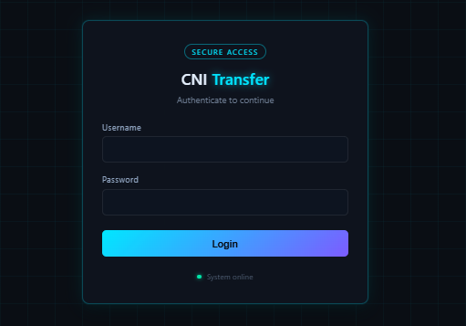
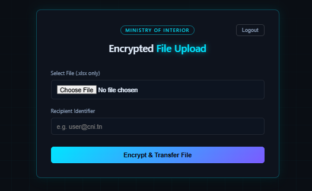
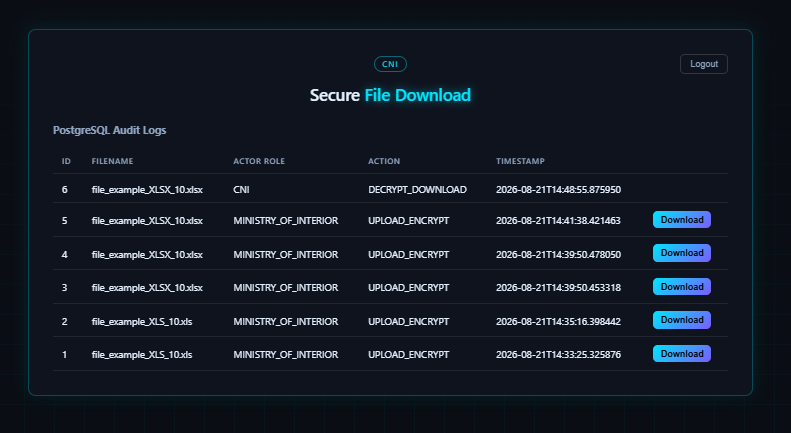

# CNI Secure Transfer

A secure, role-based document transfer system built for exchanging sensitive files between the **Ministry of Interior** and the **CNI (Centre National de l'Informatique)**. Files are encrypted at rest with AES-256-GCM, every transfer is logged to a PostgreSQL audit trail, and access is restricted by role using JWT authentication.

---

## Overview

- **Ministry of Interior** users upload Excel files (`.xlsx` / `.xls`). Each file is automatically scanned for sensitive data patterns, then encrypted before being stored.
- **CNI** users can view the full audit log and download/decrypt files that were transferred to them.
- Every upload and download is recorded in PostgreSQL with a timestamp, actor, filename, and action type — creating a full audit trail.

---

## Tech Stack

**Frontend**
- Angular 19 (standalone components, zoneless change detection)
- TypeScript, RxJS

**Backend**
- FastAPI (Python)
- SQLAlchemy + PostgreSQL
- JWT authentication (`pyjwt`)
- Password hashing via `passlib` (bcrypt)
- AES-256-GCM file encryption via PyCryptodome
- `pandas` for Excel content scanning

**Infrastructure**
- Docker / Docker Compose (PostgreSQL container)

---

## Architecture

```
Angular Frontend (localhost:4200)
        │
        │  JWT Bearer Token
        ▼
FastAPI Backend (localhost:8000)
        │
        ├── /login                          → issues JWT (role + username)
        ├── /api/interior/upload            → MINISTRY_OF_INTERIOR only
        ├── /api/cni/download/{file_name}   → CNI only
        └── /api/admin/logs                 → audit trail
        │
        ▼
PostgreSQL (Docker container, port 5432)
```

Role separation is enforced **server-side** via JWT role claims — the Interior dashboard and CNI dashboard are separate Angular routes/components, each guarded on the frontend and validated again on the backend for every request.

---

## Screenshots

### Login



### Ministry of Interior — Upload


### CNI — Download & Audit Logs


---

## Getting Started

### Prerequisites
- Python 3.11+
- Node.js + Angular CLI
- Docker Desktop

### 1. Start the database
```bash
docker-compose up -d db
```

### 2. Backend setup
```bash
python -m venv venv
source venv/Scripts/activate      # Windows (Git Bash)
pip install -r requirements.txt
uvicorn app:app --reload
```
Backend runs at `http://localhost:8000`.

### 3. Seed a user
Edit `seed_user.py` with a username, password, and role (`CNI` or `MINISTRY_OF_INTERIOR`), then:
```bash
python seed_user.py
```

### 4. Frontend setup
```bash
cd frontend
npm install
ng serve
```
Frontend runs at `http://localhost:4200`.

---

## Core Flow

1. A **Ministry of Interior** user logs in and uploads an `.xlsx`/`.xls` file.
2. The backend scans the file for sensitive data, encrypts it with AES-256-GCM, and logs the event to PostgreSQL.
3. A **CNI** user logs in, sees the file appear in the audit log table, and downloads it — the backend decrypts it on the fly before sending it back.

---

## Security Notes

- Passwords are hashed with bcrypt, never stored in plaintext.
- JWTs are short-lived (8 hours) and carry both role and username claims.
- File encryption uses AES-256-GCM (authenticated encryption).
- Role checks are enforced on the backend for every protected endpoint — the frontend routing is a UX convenience, not the security boundary.

---

## Status

Core end-to-end flow (login → upload → encrypt → log → download → decrypt) is functional. Planned improvements: recipient-based file routing, richer sensitive-data scan reporting, production-ready `.env`/secrets handling, and UI polish.

*cni secure transfer — by Nero*
